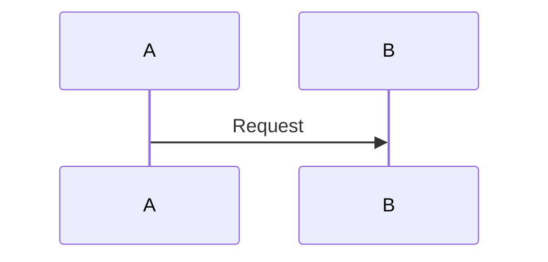

# Расширения Markdown Bridge для Confluence

## Назначение

`Confluence Markdown Bridge` поддерживает систему расширений, которая позволяет
добавлять специальные markdown-конструкции и отображать их в Confluence через
native macro и storage format.

Встроенные расширения подключаются **по умолчанию**:

- через Python API
- через HTTP API
- через MCP tools

Базовый markdown bridge продолжает работать и без них.
Если нужно полностью отключить встроенные расширения, можно передать пустой
список `enabled_extensions=[]`.

## Встроенные расширения

### 1. `toc`

Назначение:

- поддержка `[TOC]`, `[[TOC]]` и `[TOC maxLevel=3]`

Что делает:

- Markdown -> Confluence: превращает маркер в `toc` macro
- если указан `maxLevel`, добавляет внутрь `ac:structured-macro` дочерний элемент `ac:parameter ac:name="maxLevel"`
- Confluence -> Markdown: возвращает `[TOC]` или `[TOC maxLevel=...]`

Пример:

```md
[TOC]

[TOC maxLevel=3]
```

### 2. `admonitions`

Назначение:

- поддержка информационных и предупреждающих блоков

Поддерживаемый синтаксис:

```md
> [!NOTE]
> Текст справки

> [!INFO]
> Информационный блок

> [!TIP]
> Подсказка

> [!WARNING]
> Важное предупреждение

> [!ERROR]
> Ошибка или критичное замечание
```

Что делает:

- Markdown -> Confluence:
  - `NOTE` -> `note`
  - `INFO` -> `info`
  - `TIP` -> `tip`
  - `WARNING` -> `warning`
  - `ERROR` -> `panel` с красным оформлением
- Confluence -> Markdown:
  - известные macro возвращаются обратно в markdown admonition syntax

### 3. `code_blocks`

Назначение:

- поддержка code block с заголовком и языком

Поддерживаемый синтаксис:

````md
```python {title="example.py"}
print("hello")
```
````

Что делает:

- Markdown -> Confluence:
  - language -> параметр `language`
  - title -> параметр `title`
  - создаётся `code` macro
- Confluence -> Markdown:
  - `code` macro с title и language возвращается в fenced code block

### 4. `jira_links`

Назначение:

- поддержка Jira-ссылок в обычном markdown-формате

Поддерживаемый синтаксис:

```md
[KAN-123](https://jira.example.local/browse/KAN-123)

[Задача по релизу](https://jira.example.local/browse/KAN-456)
```

Что делает:

- Markdown -> Confluence:
  - преобразует ссылку в native Confluence link с `ri:url`
- Confluence -> Markdown:
  - возвращает обычную markdown-ссылку
  - если текст ссылки отсутствует, использует ключ задачи

### 5. `date_element`

Назначение:

- поддержка даты через HTML-тег `time`

Поддерживаемый синтаксис:

```md
[date:2026-07-20]

<time datetime="2026-07-20">2026-07-20</time>

<time datetime="2026-07-20"/>
```

Что делает:

- Markdown -> Confluence:
  - понимает короткий синтаксис `[date:YYYY-MM-DD]`
  - понимает полный тег `time`
  - понимает self-closing тег `time`
- Confluence -> Markdown:
  - всегда возвращает `<time datetime="YYYY-MM-DD">YYYY-MM-DD</time>`

### 6. `status_element`

Назначение:

- поддержка цветного статуса Confluence

Поддерживаемый синтаксис:

```md
<status color="Green" subtle="true">Готово</status>
```

Что делает:

- Markdown -> Confluence:
  - преобразует тег в native `status` macro
- Confluence -> Markdown:
  - возвращает `<status color="..." subtle="...">...</status>`

### 7. `mermaid_diagrams`

Назначение:

- поддержка Server/Data Center-версии плагина **Mermaid Diagrams for Confluence**
  от Stratus Add-ons

Поддерживаемый синтаксис:

````md



````

Что делает:

- Markdown -> Confluence Server/Data Center:
  - создаёт plain-text attachment без расширения с исходником Mermaid, как требует
    REST-контракт Stratus Add-ons
  - при первой публикации создаёт недостающие `<name>.svg` и `<name>.png`, без
    которых редактор плагина не может сохранить диаграмму; существующие превью
    плагина не перезаписываются
  - добавляет macro `mermaid-cloud` с параметрами `filename`, `revision`, `format`,
    `zoom` и `toolbar`
  - при обновлении версионирует attachment и увеличивает `revision`
- Confluence -> Markdown:
  - скачивает исходный attachment
  - возвращает fenced-блок `mermaid`

Расширение автоматически включается только при `deployment: server`.
Для Cloud этот attachment-based формат не применяется.

### 8. `table_excerpts`

Назначение:

- поддержка Server/Data Center-макросов **Table Excerpt** и
  **Table Excerpt Include** из приложения Stiltsoft
  **Table Filter, Charts & Spreadsheets for Confluence**
- повторное использование таблиц на одной или разных страницах
- объединение таблиц с одинаковыми колонками в сводную таблицу
- обратимое преобразование `Markdown -> Confluence -> Markdown`

Расширение автоматически включается только при `deployment: server`.

#### Исходная таблица

```md
<table-excerpt name="project-status">

| Project | Owner | Status |
| --- | --- | --- |
| Alpha | Ivan | Active |

</table-excerpt>
```

Будет создан macro `table-excerpt` с параметром `name=project-status`.
Внутри блока можно использовать не только простую Markdown-таблицу, но и другое
содержимое, которое поддерживает Markdown Bridge.

#### Вставка таблицы с текущей страницы

```md
<table-excerpt-include
  name="project-status"
  source="current"
  show-source="true"
/>
```

Соответствие параметров:

| Markdown | Confluence storage parameter |
| --- | --- |
| `name` | `name` |
| `source` | `excerptSource` |
| `source-type` | `type` |
| `show-source` | `copytable` |
| `report` | `merge-tables` |
| `transpose` | `transpose` |
| `page` | структурированный `page` с `ri:page` |

#### Сводная таблица с другой страницы

```md
<table-excerpt-include
  name="project-status"
  source-type="page"
  page="DOC:Projects"
  report="true"
  transpose="auto"
  param-v="2"
/>
```

`report="true"` включает режим сводной таблицы
(`merge-tables=true`). Все найденные Table Excerpt с одинаковым именем и
совместимыми колонками объединяются в одну таблицу.

Параметры `source` и `source-type` оставлены раздельными намеренно:
у разных версий приложения встречаются storage-параметры `excerptSource` и
`type`. Используй вариант, который создаёт редактор вашей версии Confluence.

#### Дополнительные параметры установленной версии

Любой текстовый storage-параметр можно передать без отдельной доработки:

```md
<table-excerpt-include
  name="project-status"
  param-type="page"
  param-merge-tables="true"
  param-v="2"
/>
```

Префикс `param-` удаляется, а оставшееся имя записывается как точное имя
`ac:parameter`. При экспорте неизвестные текстовые параметры возвращаются в
том же виде. Неизвестные параметры со вложенным XML выгружаются как
`xml-param-*` с Base64-значением и также восстанавливаются при повторной
публикации.

Чтобы узнать точные параметры своей версии:

1. Настрой macro через редактор Confluence и сохрани страницу.
2. Выгрузи страницу через `GET /api/v1/page/{page_id}/markdown` или MCP tool
   `export_page_to_markdown`.
3. Используй полученный блок `table-excerpt-include` как шаблон.
4. Меняй дружелюбные атрибуты и `param-*`, не редактируя
   `xml-param-*` вручную.

Описание поведения макросов:
[Stiltsoft Table Excerpt and Table Excerpt Include](https://docs.stiltsoft.com/tfac/dc-server/how-to-use-table-excerpt-and-table-excerpt-include-macros-42241623.html).

## Как управлять расширениями

По умолчанию уже включены все встроенные расширения:

- `toc`
- `admonitions`
- `code_blocks`
- `date_element`
- `jira_links`
- `status_element`
- `mermaid_diagrams` (только `deployment: server`)
- `table_excerpts` (только `deployment: server`)

Если этого достаточно, `enabled_extensions` можно вообще не передавать.

Если нужно оставить только часть расширений, передай явный список.

Если нужно отключить все встроенные расширения, передай пустой список:

```python
enabled_extensions=[]
```

### Через Python API

```python
from confluence_markdown_service import ConfluenceMarkdownImporter

importer = ConfluenceMarkdownImporter(
    client,
)
```

Для экспорта:

```python
from confluence_markdown_service import ConfluenceMarkdownExporter

exporter = ConfluenceMarkdownExporter(
    client,
)
```

Пример явного ограничения только двумя расширениями:

```python
importer = ConfluenceMarkdownImporter(
    client,
    enabled_extensions=["toc", "jira_links", "date_element", "status_element"],
)
```

### Через HTTP API

Preview markdown:

```json
{
  "markdown": "> [!WARNING]\n> Важное предупреждение"
}
```

Создание страницы из markdown:

```json
{
  "title": "Runbook",
  "parent_id": "12345",
  "space_key": "DOC",
  "markdown": "```python {title=\"example.py\"}\nprint(\"hi\")\n```"
}
```

Для выгрузки страницы в markdown через GET:

```text
/api/v1/page/163939/markdown
```

Если нужно вручную ограничить набор расширений:

```text
/api/v1/page/163939/markdown?enabled_extensions=toc,jira_links,date_element,status_element
```

### Через MCP

Пример preview:

```json
{
  "tool": "preview_markdown_to_storage",
  "arguments": {
    "markdown_text": "> [!NOTE]\n> Полезная справка"
  }
}
```

Пример создания страницы:

```json
{
  "tool": "create_page_from_markdown",
  "arguments": {
    "title": "Example",
    "parent_id": "12345",
    "space_key": "DOC",
    "markdown_text": "```python {title=\"example.py\"}\nprint(\"hi\")\n```"
  }
}
```

Если нужно отключить встроенные расширения:

```json
{
  "tool": "preview_markdown_to_storage",
  "arguments": {
    "markdown_text": "Простой текст без расширений",
    "enabled_extensions": []
  }
}
```

## Как посмотреть список расширений

### HTTP API

```text
GET /api/v1/markdown/extensions
```

### MCP

Tool:

```text
list_markdown_extensions
```

## Как добавить своё расширение

Нужно создать класс, наследующий `ConfluenceMarkdownExtension`.

Пример:

```python
from xml.etree import ElementTree as ET

from confluence_markdown_service import ConfluenceMarkdownExtension
from confluence_markdown_service.extensions.base import (
    MarkdownImportTransformResult,
    MarkdownRenderResult,
)


class ExpandExtension(ConfluenceMarkdownExtension):
    name = "expand"
    description = "Поддержка :::expand блоков"

    def preprocess_markdown(self, markdown_text: str) -> str:
        return markdown_text

    def transform_import_element(self, importer, element: ET.Element) -> MarkdownImportTransformResult:
        return MarkdownImportTransformResult()

    def render_macro(self, renderer, element: ET.Element) -> MarkdownRenderResult:
        return MarkdownRenderResult()
```

## Как подключить своё расширение

Пользовательские расширения передаются программно через `extra_extensions`.

Пример:

```python
from confluence_markdown_service import ConfluenceMarkdownImporter

custom_extension = ExpandExtension()

importer = ConfluenceMarkdownImporter(
    client,
    enabled_extensions=["toc", "admonitions", "date_element", "status_element"],
    extra_extensions=[custom_extension],
)
```

Для экспорта:

```python
from confluence_markdown_service import ConfluenceMarkdownExporter

exporter = ConfluenceMarkdownExporter(
    client,
    enabled_extensions=["toc", "admonitions", "date_element", "status_element"],
    extra_extensions=[custom_extension],
)
```

## Рекомендации для авторов расширений

- не менять работу базового markdown bridge, если расширение не включено
- по возможности сохранять обратимость `Markdown -> Confluence -> Markdown`
- использовать warnings, если точный roundtrip невозможен
- не ломать экспорт на неизвестных блоках
- оставлять fallback до plain text, если форматирование не удаётся сохранить

## Ограничения текущей версии

- встроенные расширения активны по умолчанию, если не передан пустой список `enabled_extensions=[]`
- пользовательские расширения пока подключаются программно, а не через YAML-конфиг
- `admonitions` рассчитаны на поддерживаемый поднабор blockquote syntax
- `code_blocks` ориентирован на fenced code block с атрибутом `title`
